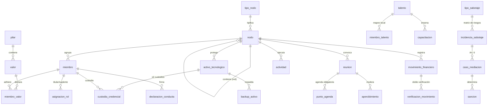

# NODOS — Red de Base de Datos de la Organización

**NODOS: Conciencia, Tecnología y Comunidad.**

Sistema de base de datos que materializa la red de *nodos* como estructura organizativa
principal de un país, para fomentar **valores**, garantizar la **transparencia de los recursos
a invertir** y promover el **desarrollo humano**, replicable en hogares, emprendimientos y
grupos locales.

Implementa la **Matriz Fundacional** y el **Reglamento RGL-NOD-001** como reglas de la base
de datos (no solo como documentos).

## Motor y estructura

- PostgreSQL 14+ (esquema `nodos`).
- `sql/01_esquema.sql` — tablas, tipos y relaciones.
- `sql/02_restricciones.sql` — triggers que codifican el reglamento interno.
- `sql/03_datos_semilla.sql` — pilares, valores, roles y matriz de riesgos de sabotaje.
- `sql/04_vistas.sql` — libro contable compartido, alertas y panel del nodo.

```bash
psql -c "CREATE DATABASE nodos;"      # opcional: propia base
psql -d nodos -f sql/01_esquema.sql
psql -d nodos -f sql/02_restricciones.sql
psql -d nodos -f sql/03_datos_semilla.sql
psql -d nodos -f sql/04_vistas.sql
```

## Cómo el modelo refleja la Trinidad Conceptual

| Pilar | Tablas |
| --- | --- |
| **La Raíz: Conciencia** | `pilar`, `valor`, `miembro_valor` (filtro ético Art. 1), `declaracion_conducta` (no proselitismo), `apercibimiento`, `caso_mediacion`, `sancion` |
| **La Base: Tecnología** | `activo_tecnologico`, `custodia_credencial` (mínimo 2 custodios, Art. 3), `backup_activo`, `movimiento_financiero` + `verificacion_movimiento` (doble verificación, Art. 4) |
| **La Matriz: Comunidad** | `nodo` (red jerárquica), `miembro`, `asignacion_rol` (titular/suplente, Art. 5), `actividad`, `talento`, `miembro_talento`, `capacitacion`, `incidencia_sabotaje` |

## La red

`nodo` se auto-referencia (`nodo_padre_id`): un nodo comunidad agrupa nodos de grupo
local, emprendimientos y hogares. La vista `vw_red_nodos` muestra la jerarquía completa
del país con profundidad y ruta (p. ej. `NODO-PAIS > NODO-NORTE > NODO-NORTE-001`).

## Reglas anti-sabotaje codificadas

| Artículo | Regla en la base |
| --- | --- |
| Art. 1 | `miembro.estado` con control de admisión + `miembro_valor` (valores declarados) |
| Art. 2 | `CHECK` en `reunion`: agenda publicada **antes** de la reunión; `minutos_por_persona ≤ 3`; `apercibimiento` con primera amonestación y retiro |
| Art. 3 | Constraint trigger diferible: todo activo exige ≥ 2 custodios distintos; credenciales nunca en claro (solo `referencia_boveda`) |
| Art. 4 | Errores si una erogación se aprueba sin factura, sin 2 verificaciones favorables, o si el verificador es el propio registrador |
| Art. 5 | `actividad.suplente_id ≠ titular_id`; el suplente debe estar habilitado; alerta de puestos sin suplente |
| Art. 6 | `caso_mediacion` con las 3 fases; al expulsar, se revocan roles, custodias y accesos automáticamente |

## Alertas operativas (vistas)

- `vw_libro_contable` — libro contable compartido e informatizado.
- `vw_alerta_transparencia` — erogaciones sin soporte o sin doble verificación.
- `vw_alerta_custodia` — activos con custodios insuficientes.
- `vw_alerta_continuidad` — roles/actividades sin suplente o con suplente inhabilitado.
- `vw_backup_vencidos` — backups atrasados (riesgo de secuestro de canales).
- `vw_panel_nodo` — resumen integral de cada nodo (miembros, actividades, saldo neto).

## Diagrama entidad-relación



## Principio rector

> Activando la Conciencia, implementando la Tecnología y sirviendo a la Comunidad,
> se construye un tejido inquebrantable para el desarrollo integral.
